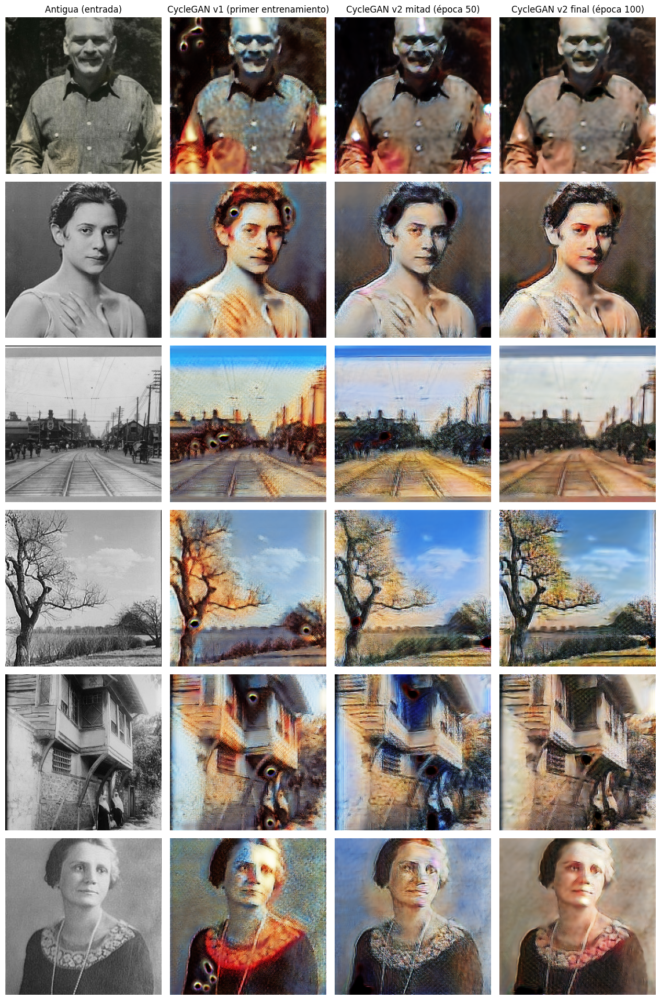
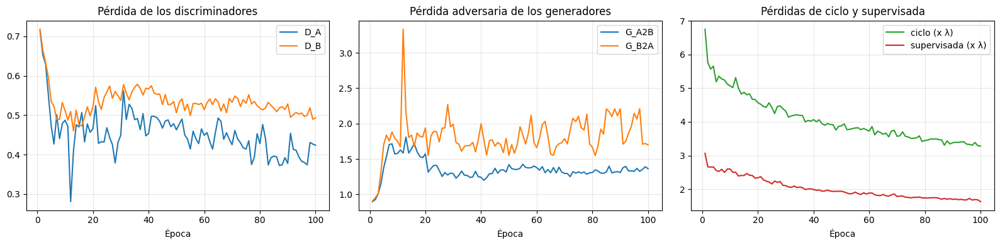

# Restauración de fotografías antiguas con CycleGAN

Tercer miniproyecto de Redes Neuronales Artificiales y Deep Learning (Grupo 7, Universidad Autónoma de Occidente, Cali).

## Video pitch

[](https://youtu.be/hcVU_OtJl6E)

[Ver el video de sustentación en YouTube](https://youtu.be/hcVU_OtJl6E)


La idea del proyecto es tomar una foto antigua (en blanco y negro o sepia, con poco contraste, algo borrosa) y devolverla con color y con aspecto de foto actual. Como no existen pares "foto vieja / misma foto restaurada", lo planteamos como una traducción no pareada entre dos dominios y usamos una CycleGAN:

- Dominio A: fotos antiguas, anteriores a 1960, sacadas de la Library of Congress.
- Dominio B: fotos modernas a color, tomadas desde el 2000, sacadas de Wikimedia Commons (Quality images).

El primer entrenamiento (v1) dejaba manchas oscuras y en casi todas las métricas salía peor que no hacerle nada a la foto. En la v2, que es la del informe, le agregamos una pérdida supervisada: en cada paso tomamos una foto moderna, la "envejecemos" a propósito (gris o sepia, desenfoque, menos contraste y ruido) y le pedimos al generador que recupere la original. Además pusimos decaimiento en la tasa de aprendizaje y cambiamos las subidas a interpolación bilineal.

El informe está en `docs/informe_miniproyecto3.pdf`.

## Qué hay en el repo

```
datos/
  fuentes.csv       de dónde salió cada imagen (título, fecha, autor, licencia, URL)
  particion.csv     qué fotos son de entrenamiento y cuáles de prueba
docs/
  informe_miniproyecto3.pdf
notebooks/
  Preparar_Dataset_CycleGAN.ipynb                       descarga y filtra el dataset
  Miniproyecto3_Restauracion_CycleGAN.ipynb             v1
  Miniproyecto3_Restauracion_CycleGAN_v2.ipynb          v2 (la del informe)
  Miniproyecto3_Restauracion_CycleGAN_v2_sin_sup.ipynb  v2 sin la pérdida supervisada
  Miniproyecto3_Restauracion_CycleGAN_v3.ipynb          v2 con BatchNorm en el generador
resultados/
  v1/  v2/  v2_sin_sup/  v3/
```

Cada carpeta de `resultados/` tiene la tabla de métricas (`tabla_metricas.csv`), el historial de pérdidas por época, las curvas, las restauraciones sobre las fotos de prueba, una imagen de la foto de prueba cada 5 épocas (`progreso/`) y las fotos externas que probamos (`propias/`).

Los pesos entrenados y los zip del dataset no están aquí porque pesan mucho. Los tenemos en Google Drive.

## Dataset

Lo armamos con `Preparar_Dataset_CycleGAN.ipynb`. Son 150 fotos por dominio y las dos partes tienen la misma mezcla: 74 retratos, 38 paisajes y 38 urbanas. Hicimos así para que la red no relacionara un tipo de escena con un estilo.

Al descargar se filtraron automáticamente:

- fotos con el lado menor por debajo de 256 px;
- panorámicas con proporción mayor a 2:1;
- retratos sin una cara de frente (detector Haar de OpenCV);
- duplicados, exactos (MD5) o la misma foto en otro tamaño (dHash).

En A además se descartaron las diapositivas a color desteñidas y se recortaron los marcos. En B dejamos máximo 3 fotos por fotógrafo. Los casi duplicados (la misma escena con otro encuadre) los quitamos a mano.

La partición es 120 fotos de entrenamiento y 30 de prueba por dominio, estratificada por categoría y con semilla 42. Está guardada en `datos/particion.csv`. El cuaderno la compara en cada corrida y se detiene si el dataset cambió, para que nunca se cuele una foto de prueba en el entrenamiento.

## Cómo correr la v2 sin entrenar

Es el modo que usamos en la sustentación. Con `ENTRENAR = False` el cuaderno no entrena: carga los pesos que ya teníamos, vuelve a calcular las métricas y deja subir fotos propias. Toma unos minutos, contra casi tres horas que dura el entrenamiento.

### Lo que tiene que estar en Drive

El cuaderno busca todo en `MyDrive/CycleGAN/`. Esa ruta es la variable `ROOT` de la celda 2 y se puede cambiar.

```
MyDrive/CycleGAN/
  trainA.zip
  trainB.zip
  resultados/particion.csv          (copia de datos/particion.csv)
  models_restore_v2/
    G_A2B_final.weights.h5
    G_B2A_final.weights.h5
    G_A2B_mitad.weights.h5          (opcional)
    G_B2A_mitad.weights.h5          (opcional)
  models_restore/                   (opcional, pesos de la v1)
  checkpoints_restore_v2/           (solo para el diagnóstico de la celda 25)
```

Sin los dos zip y los dos pesos `final`, el cuaderno no corre. Los pesos de la mitad del entrenamiento sirven para la fila de la época 50 de la tabla, y los de `models_restore/` para la fila de la v1. Si alguno falta, el cuaderno muestra un aviso y deja esa fila por fuera.

Si `particion.csv` no está, el cuaderno la genera. Como la semilla es fija, con el mismo dataset sale igual.

### Pasos

1. Abrir `notebooks/Miniproyecto3_Restauracion_CycleGAN_v2.ipynb` en Colab.
2. Poner el entorno con GPU (Entorno de ejecución → Cambiar tipo de entorno de ejecución). Con una T4 funciona.
3. Revisar que en la celda 2 diga:

   ```python
   ENTRENAR = False
   VERSION = "v2"
   ```

   Con `True` entrena desde cero, o retoma desde el último checkpoint si Colab se desconectó a mitad de camino.
4. Ejecutar todo y dar permiso a Drive.

La celda 15 es la del entrenamiento. Con la bandera en `False` se salta el bucle y carga `G_A2B_final` y `G_B2A_final`. La 16 dibuja las curvas a partir del `historial_perdidas.csv` que quedó del entrenamiento. Las celdas 17 a 21 calculan las métricas y arman la tabla. La 22 abre un selector para subir fotos y se queda esperando hasta que se escoja algo, así que si no van a probar fotos propias la pueden cancelar. De la 23 a la 26 están los diagnósticos que usamos para explicar los resultados.

Todo lo que se genera queda en `MyDrive/CycleGAN/resultados_v2/`. La carpeta `resultados/v2/` del repo es una copia de esa.

En Colab no hay que instalar nada: TensorFlow/Keras, NumPy, pandas, matplotlib, scikit-learn y SciPy ya vienen. Fuera de Colab habría que cambiar el montaje de Drive y el `files.upload()`.

## El modelo

El generador es tipo ResNet:

- una convolución de 7×7 y dos bajadas con paso 2;
- 6 bloques residuales;
- dos subidas con `UpSampling2D` bilineal más una convolución (en lugar de `Conv2DTranspose`, para evitar el patrón de tablero de ajedrez);
- una convolución final de 7×7 con `tanh`.

Usa normalización por instancia y relleno por reflexión. El discriminador es un PatchGAN: en vez de dar un solo "real o falso", da una rejilla de 32×32 en la que cada valor evalúa un pedazo de la imagen.

Las pérdidas son:

- la adversaria, con suavizado de etiquetas de 0.1;
- la de ciclo, con λ = 10;
- la de identidad, con 0.5·λ;
- la supervisada sobre las fotos envejecidas, también con peso 10.

Ese peso no lo ajustamos; lo pusimos igual al del ciclo.

Entrenamos 100 épocas con Adam (β₁ = 0.5) y lote 1. La tasa baja de 2e-4 a 2e-5. Cada época tomó unos 98 segundos, unas 2 horas y 44 minutos en total.

Las versiones que probamos:

| Versión | Qué cambia |
|---|---|
| v1 | CycleGAN base, subidas por vecino más cercano, tasa fija |
| v2 | pérdida supervisada + decaimiento de la tasa + subida bilineal |
| v2_sin_sup | la v2 sin la pérdida supervisada, para ver cuánto aporta |
| v3 | la v2 con BatchNorm en el generador y lote 4 (sugerencia del profesor) |

## Resultados

Todo se midió sobre las 30 fotos de prueba de cada dominio. Como no hay una restauración "correcta" con la cual comparar, usamos varias medidas:

- **Ciclo L1:** pasa la foto de A a B y de vuelta a A, y mide cuánto cambió. Sirve para ver si se conserva el contenido.
- **PSNR y SSIM:** se toman fotos modernas de prueba, se envejecen, se restauran y se comparan con la original.
- **KID y FID:** miden qué tan lejos quedan las fotos restauradas de fotos modernas reales, usando características de InceptionV3.
- **Inception Score, precisión y recuperación:** las pidió el profesor.

La línea base es la "identidad", es decir, entregar la foto sin tocarla.

Tabla de la v2 (`resultados/v2/tabla_metricas.csv`):

| Modelo | Ciclo A→B→A | Ciclo B→A→B | PSNR (dB) | SSIM | KID ×10³ | FID | IS | Precisión | Recuperación |
|---|---|---|---|---|---|---|---|---|---|
| Identidad | | | 15.48 ± 1.65 | 0.369 ± 0.062 | 81.8 ± 4.1 | 319.5 | 7.66 | 0.20 | 0.63 |
| v1, época 100 | 0.080 | 0.101 | 15.85 ± 1.53 | 0.397 ± 0.068 | 102.7 ± 7.0 | 343.6 | 3.91 | 0.30 | 0.17 |
| v2, época 50 | 0.083 | 0.105 | 17.68 ± 1.80 | 0.556 ± 0.101 | 75.9 ± 6.4 | 329.0 | 5.56 | 0.40 | 0.27 |
| v2, época 100 | 0.072 | 0.098 | 18.15 ± 1.93 | 0.572 ± 0.100 | 67.2 ± 3.3 | 306.8 | 4.45 | 0.43 | 0.40 |
| B entren. vs B prueba | | | | | −2.7 ± 3.0 | 223.0 | 7.81 | 0.82 | 0.80 |

En ciclo, KID y FID menor es mejor; en el resto, mayor es mejor. La última fila compara dos grupos de fotos modernas reales entre sí. La pusimos porque con solo 30 fotos el FID sale inflado, y esa fila muestra más o menos el mejor valor que se puede esperar con este tamaño de muestra.

Los otros dos experimentos, comparados con la v2 (todos en la época 100):

| Modelo | PSNR (dB) | SSIM | KID ×10³ | FID | IS | Precisión | Recuperación |
|---|---|---|---|---|---|---|---|
| v2 | 18.15 | 0.572 | 67.2 | 306.8 | 4.45 | 0.43 | 0.40 |
| v2_sin_sup | 16.15 | 0.459 | 74.4 | 318.7 | 4.34 | 0.40 | 0.30 |
| v3 | 14.88 | 0.480 | 49.5 | 296.4 | 4.88 | 0.43 | 0.47 |

Lo que sacamos de estas tablas:

- **La v2 sí mejora la foto.** Frente a la identidad gana 2.7 dB de PSNR y 0.20 de SSIM, y baja el KID y el FID. La v1 no lo lograba.
- **La pérdida supervisada es la que hace la diferencia.** Al quitarla, el PSNR baja 2 dB y el SSIM cae 0.11, y en las imágenes vuelven el desenfoque y el ruido.
- **La v3 no sirve como restauración.** Con BatchNorm desaparecen las manchas y tiene el mejor KID y FID, pero las fotos salen borrosas y el PSNR queda incluso por debajo de no hacer nada.

También hay cosas que no funcionaron. En la v2 el Inception Score y la recuperación quedan por debajo de la identidad, la textura no termina de parecer de foto real y el modelo no arregla roturas ni partes faltantes. Además, el envejecimiento sintético que usamos para medir no es igual al envejecimiento real de una foto, y con 30 imágenes el FID, el IS y la precisión-recuperación varían bastante.

Algunas restauraciones de la v2 sobre fotos antiguas de prueba:



Curvas de pérdida de la v2:



## Sobre el código

Cada celda empieza con un comentario `# Fuente:` que indica de qué cuaderno y de qué celda del curso salió lo que se usa ahí. Lo que no estaba en ningún cuaderno del curso lo marcamos con `# EXCEPCIÓN` y un código. La lista de códigos está en la primera celda de cada cuaderno.

La arquitectura se basa en el [tutorial de CycleGAN de TensorFlow](https://www.tensorflow.org/tutorials/generative/cyclegan) y en el [repositorio original](https://github.com/junyanz/pytorch-CycleGAN-and-pix2pix) de Zhu et al. (2017).

Los datos de cada imagen (autor, licencia y enlace) están en `datos/fuentes.csv`. Las fotos conservan la licencia de su fuente original.

## Integrantes

Sara Stephania Moreno Sánchez, Juan Diego Hernández Loaiza, Sarah Sepúlveda Gómez, Juan Pablo Rivas Castillo y Hernán David Gutiérrez Alarcón.
